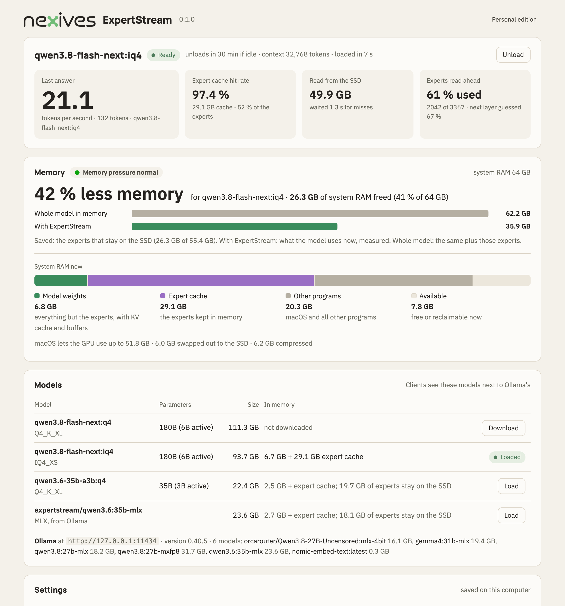

<picture>
  <source media="(prefers-color-scheme: dark)" srcset="img/nexives-logo-light.png">
  
</picture>

# NEXIVES ExpertStream

**Run Mixture-of-Experts language models that are larger than your Mac's memory.**

Models such as Qwen3.8-Flash-Next use only a small part of their weights for each token: a few of hundreds of
“experts” per layer. ExpertStream keeps in memory what every token needs and the experts in use, and reads the other
experts from the SSD in milliseconds when a token needs them. Qwen3.8-Flash-Next is a 93.7 GB model; with ExpertStream
it runs on a MacBook Pro with 64 GB at about 20 tokens per second.

* **Works with what you use:** your apps talk to ExpertStream like to Ollama or to an OpenAI-compatible server. With
  Ollama installed, ExpertStream's models appear in Ollama's own model list.
* **Uses the models you have:** besides its own downloads, ExpertStream streams the Mixture-of-Experts models Ollama
  keeps in its MLX format — no second download.
* **Shows what it does:** a web view with speed, cache, memory saved and every request; an icon in the menu bar.
* **Private:** everything runs on your Mac; prompts and answers never leave it.

## Download

**[Download the latest version](../../releases/latest)** — `NEXIVES-ExpertStream-<version>-macOS-arm64.dmg`, with the
How-To guide (PDF) next to it.

| | Needed |
|---|---|
| Mac | Apple silicon (M1 or later); 32 GB of memory or more, 64 GB for Qwen3.8-Flash-Next |
| macOS | 14 Sonoma or later |
| SSD space | the models you download (Qwen3.8-Flash-Next IQ4_XS: 93.7 GB) plus 1 GB for the app |

## Install

1. Open the disk image and drag **ExpertStream** to **Applications**.
2. Open ExpertStream from Applications. This version is not yet notarized by Apple: if macOS says it cannot check the
   app, open **System Settings → Privacy & Security** and click **Open Anyway** next to ExpertStream (needed once).
3. The web view opens in your browser at `http://127.0.0.1:11435/`. Download a model there, or use one Ollama already
   has.

The How-To guide covers models, settings, Ollama, OpenClaw and other apps, the command line, speed and memory, and
what to do if something does not work.

To check the download, compare its SHA-256 with the `.sha256` file of the release:

```bash
shasum -a 256 NEXIVES-ExpertStream-*-macOS-arm64.dmg
```

## Measured on a MacBook Pro (M5 Pro, 64 GB)

| Model | Memory used | Speed |
|---|---|---|
| Qwen3.8-Flash-Next IQ4_XS (180B, 93.7 GB file) | 36 GB instead of 62 GB: 42 % less memory for this model, 26 GB of system RAM freed | about 20–22 tokens/s; long prompts about 300–400 tokens/s |
| Qwen3.6-35B (Q4, 22.4 GB file) | 9 GB instead of 22 GB with a third of the experts cached | 38 tokens/s (64 with the whole model in memory) |

Speed depends on how much memory is free for the expert cache: close memory-heavy programs for the best result.



## License

Free for personal, non-commercial use. Use by or for a company or other organisation, use as part of a paid product or
service, and serving other computers on the network need a business license: **info@nexives.com**. The license terms
are included in the app.

This repository contains the downloads only; NEXIVES ExpertStream is not open source. It includes llama.cpp (MIT
license); the notices are in the app.

## Contact

Questions, business licenses and feedback: **info@nexives.com**
